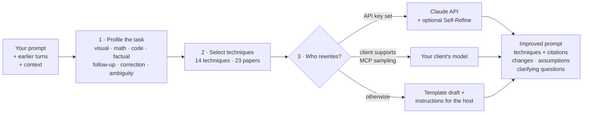

<div align="center">

# 🪄 prompt-improver-mcp

**Turn rough prompts into ones models answer well, using techniques from 23 research papers.**

An [MCP](https://modelcontextprotocol.io) server and command-line tool. It reads your prompt together with the
conversation it belongs to, works out what kind of task it is, and rewrites it with the techniques that fit, from
LLaVA-CoT's staged reasoning to System 2 Attention and Chain-of-Verification. Every change names the paper it comes from.

[](https://github.com/SMASH-Mash/prompt-improver-mcp/actions/workflows/ci.yml)
[](https://www.python.org/)
[](https://modelcontextprotocol.io)
[](#-techniques)
[](LICENSE)

[Quick start](#-quick-start) · [Usage](#-usage) · [How it works](#-how-it-works) · [Techniques](#-techniques) · [FAQ](#-faq)

</div>

---

## ✨ What it does

You send a follow-up after an answer that didn't work:

> **Earlier:** *Our Stripe webhook handler sometimes charges customers twice. Here is handler.py: …*<br>
> **Assistant:** *Wrap `charge()` in a try/except and log failures so you can see what happens.*<br>
> **You:** **no, it still double-charges when Stripe retries the webhook. fix it**

On its own, "fix it" gives a model almost nothing to work with. prompt-improver notices that this is a correction of
a code answer and makes the prompt self-contained: it brings back the earlier request and the code, quotes the answer
that failed, and asks the model to diagnose what fell short instead of repeating it:

````xml
<context>
[earlier assistant response]
Wrap charge() in a try/except and log failures so you can see what happens.
</context>

<task>
Earlier request:
Our Stripe webhook handler sometimes charges customers twice. Here is handler.py:

```python
def on_event(evt):
    if evt.type == "invoice.paid":
        charge(evt.customer, evt.amount)
```

My feedback on your previous answer:
no, it still double-charges when Stripe retries the webhook. fix it

Work out specifically what fell short in the previous answer, keep what was correct, and fix the problem rather than repeating the earlier answer.
</task>

<approach>
- If a detail you need is missing, state the assumption you are making in one line, then answer under that assumption.
</approach>

<output_format>
Start with the direct answer or deliverable, then any explanation that is needed.
</output_format>
````

Techniques applied: System 2 Attention · conversational query rewriting · textual-gradient correction (ProTeGi,
Self-Refine) · Rephrase-and-Respond · principled instructions. This is the offline template draft, produced without
any LLM. With a Claude API key, or a client that supports MCP sampling, an LLM does the full rewrite.

### Why use it

- 🧵 **It uses the conversation.** It resolves "it" and "the above", carries earlier constraints forward, and turns
  "that's wrong" into explicit fixes.
- 🎯 **It picks techniques per task.** Images get grounded visual description and LLaVA-CoT stages, math gets
  Plan-and-Solve, factual questions get Chain-of-Verification, vague requests get Rephrase-and-Respond.
- 🧠 **It knows reasoning models are different.** Models with built-in thinking get a structured deliverable, not
  "think step by step" (see [targets](#reasoning-vs-standard-targets)).
- 🔒 **It keeps your intent.** It never adds requirements you didn't ask for; any gap it fills is listed as an
  assumption you can override.
- 🔑 **No API key needed.** Without one, it hands a draft and instructions to the model you're already using. With a
  key, Claude does the rewrite.
- 📚 **It cites its sources.** Each technique comes with its paper and arXiv ID, and every ID was checked against arXiv.

## 🚀 Quick start

You need [uv](https://docs.astral.sh/uv/getting-started/installation/) (it fetches Python for you) and git.

**Try it from the command line, no setup:**

```bash
uvx --from git+https://github.com/SMASH-Mash/prompt-improver-mcp prompt-improver "What does this chart show?" --image
```

**Add it to your AI client:**

<details open>
<summary><b>Claude Code</b></summary>

```bash
claude mcp add --transport stdio --scope user prompt-improver -- uvx --from git+https://github.com/SMASH-Mash/prompt-improver-mcp prompt-improver-mcp
```

To let Claude do the rewriting through the API, add your key. Put `--env` first: if it comes right before the server
name, the CLI reads the name as another variable.

```bash
claude mcp add --env ANTHROPIC_API_KEY=sk-ant-... --transport stdio --scope user prompt-improver -- uvx --from git+https://github.com/SMASH-Mash/prompt-improver-mcp prompt-improver-mcp
```

Check it with `claude mcp list`.
</details>

<details>
<summary><b>Claude Desktop</b></summary>

Edit `claude_desktop_config.json`: on macOS it is in `~/Library/Application Support/Claude/`, on Windows in
`%APPDATA%\Claude\`. Then restart Claude Desktop.

```json
{
  "mcpServers": {
    "prompt-improver": {
      "command": "uvx",
      "args": ["--from", "git+https://github.com/SMASH-Mash/prompt-improver-mcp", "prompt-improver-mcp"],
      "env": { "ANTHROPIC_API_KEY": "sk-ant-..." }
    }
  }
}
```

The `env` block is optional. If Claude Desktop can't find `uvx`, use its full path (`which uvx` on macOS/Linux,
`where uvx` on Windows).
</details>

<details>
<summary><b>VS Code</b></summary>

Add to `.vscode/mcp.json` in your workspace, or to your user-level MCP configuration. VS Code supports MCP sampling,
so the rewrite can run on the chat model you already use (see the `chat.mcp.serverSampling` setting). No API key
needed.

```json
{
  "servers": {
    "prompt-improver": {
      "type": "stdio",
      "command": "uvx",
      "args": ["--from", "git+https://github.com/SMASH-Mash/prompt-improver-mcp", "prompt-improver-mcp"]
    }
  }
}
```
</details>

<details>
<summary><b>Cursor</b></summary>

Add to `~/.cursor/mcp.json`, or to `.cursor/mcp.json` in a project:

```json
{
  "mcpServers": {
    "prompt-improver": {
      "command": "uvx",
      "args": ["--from", "git+https://github.com/SMASH-Mash/prompt-improver-mcp", "prompt-improver-mcp"]
    }
  }
}
```
</details>

<details>
<summary><b>Any other MCP client</b></summary>

It is a stdio server. The command is `uvx` and the arguments are
`--from git+https://github.com/SMASH-Mash/prompt-improver-mcp prompt-improver-mcp`.

To run it from a clone instead: `uv run --directory /path/to/prompt-improver-mcp prompt-improver-mcp`.
</details>

## 🧭 Usage

**In chat**, just ask:

> *Improve this prompt: …*
> *Improve my last message, then answer it.*

The assistant calls `improve_prompt` and passes along the turns and context your prompt depends on (the server can't
see the conversation by itself).

**As a slash command**, which uses the server's `improve` prompt:

| Client | Command |
|---|---|
| Claude Code | `/mcp__prompt-improver__improve <your prompt>` |
| VS Code | `/prompt-improver.improve` |

Run it with no argument to improve your most recent message. Claude Code splits slash-command arguments on spaces, so
this is also the reliable way to pass a long prompt there.

**From the command line.** Use `uvx --from git+https://github.com/SMASH-Mash/prompt-improver-mcp prompt-improver ...`,
or put the `prompt-improver` command on your PATH with
`uv tool install git+https://github.com/SMASH-Mash/prompt-improver-mcp`:

```bash
prompt-improver "explain why my CNN overfits"                                 # template draft, or the Claude API if a key is set
prompt-improver "fix it" --history chat.json --context notes.md               # with conversation and context
prompt-improver "How many red cubes are behind the sphere?" --image --target standard
prompt-improver "summarize the paper" --technique verification --json        # force techniques, JSON output
```

`chat.json` is a list of turns, oldest first: `[{"role": "user", "content": "..."}, {"role": "assistant", "content": "..."}]`.
Run `prompt-improver --help` for every option.

## 🔬 How it works



1. **Profile.** Lexical signals classify the task (visual, math, code, factual, knowledge, multi-part, planning,
   writing). They also detect references to earlier turns, corrections of a previous answer, and how ambiguous the
   prompt is. A follow-up like "fix it" takes its task type from the turn it refers to.
2. **Select.** Rules map the profile to techniques in a fixed order: understand the request first (context, references,
   corrections), then reasoning structure, then verification and formatting.
3. **Rewrite.** The rewriter gets the inputs, the profile as *suggestions*, and a catalog of every technique. It
   follows two rules taken from the literature: never change the user's intent
   ([BPO](https://arxiv.org/abs/2311.04155)), and work through an explicit procedure
   ([PE2](https://arxiv.org/abs/2311.05661)). An optional Self-Refine pass critiques the rewrite and revises it.

### Who does the rewriting

| Backend | Used when (`backend="auto"`) | What happens |
|---|---|---|
| **Claude API** | Anthropic credentials are visible to the server (`ANTHROPIC_API_KEY`, `ANTHROPIC_AUTH_TOKEN`, or an `ant auth login` profile) | `claude-opus-5-5` rewrites with structured JSON output, and a refused request is retried server-side on a fallback model. Errors fall back to the template draft, with a note saying why. |
| **MCP sampling** | No credentials, but the client supports sampling (e.g. VS Code) | Your client's own model does the rewrite. |
| **Host** | Neither | A template draft built offline: the techniques applied as text, plus context chosen by BM25 to approximate System 2 Attention. It comes with `host_instructions` telling the calling model how to finish it. Costs nothing. |

Each result's `backend_used` field says which backend ran. Claude Code's documentation doesn't list MCP sampling, so
there it uses the API if you give it a key, and host mode otherwise.

### Reasoning vs. standard targets

[LLaVA-CoT](https://arxiv.org/abs/2411.10440) trains a vision-language model to answer in four stages:
`<SUMMARY>` → `<CAPTION>` → `<REASONING>` → `<CONCLUSION>`. Asking for that format helps models that don't think
before answering. Models with built-in thinking (current Claude, OpenAI o-series, DeepSeek-R1) reason internally;
telling them to print their reasoning adds nothing, and on recent Claude models it can trigger refusals.

| `target` | For | Output structure |
|---|---|---|
| `reasoning` (default) | Models with built-in thinking | Approach → Evidence → Answer. No reasoning transcript requested. |
| `standard` | Models without it, e.g. small open VLMs | The four LLaVA-CoT tags, plus explicit step-by-step cues |

For example, `prompt-improver "How many red cubes are behind the sphere?" --image --target standard` produces:

```xml
<task>
How many red cubes are behind the sphere?
</task>

<approach>
- First note what in the image matters for the question: the relevant objects, their attributes and how they relate
  to each other, any visible text or numbers, and the region to focus on. If something you need is not visible or
  legible, say so instead of guessing.
- Extract the relevant quantities and devise a plan, then carry out the plan step by step, checking each calculation.
</approach>

<output_format>
Answer in four stages, each wrapped in its tag (the Xu et al. 2024 format):
<SUMMARY>Restate the problem and outline how you will solve it.</SUMMARY>
<CAPTION>Describe the facts from the image that the answer depends on.</CAPTION>
<REASONING>Work through the solution step by step.</REASONING>
<CONCLUSION>Give the final answer only.</CONCLUSION>
</output_format>
```

## 🧰 Tools

| Tool | What it does |
|---|---|
| `improve_prompt` | The full pipeline. Takes `prompt` (required), plus optional `context`, `history` (`[{role, content}]`, oldest first), `target`, `has_image`, `techniques` (force a set), `refine_rounds` (0–2, Claude API only), and `backend`. |
| `analyze_prompt` | Profiles the prompt and lists the techniques that would apply, with reasons, without rewriting. |
| `list_techniques` | The full catalog, with citations. |

The server also provides an **`improve` prompt**, the slash command described [above](#-usage).

<details>
<summary>Shape of an <code>improve_prompt</code> result</summary>

```jsonc
{
  "improved_prompt": "<task>…</task> …",
  "backend_used": "anthropic | sampling | host",
  "target": "reasoning",
  "profile": { "task_types": ["code"], "references_history": true, "dissatisfied_with_previous": true, "ambiguity": "medium", … },
  "techniques": [
    { "id": "failure_feedback", "name": "Textual-gradient correction from the previous response",
      "citation": "Pryzant et al. 2023, arXiv:2305.03495; Madaan et al. 2023, arXiv:2303.17651",
      "why": "the prompt corrects or retries a previous response" }
  ],
  "changes": ["…"],
  "assumptions": ["…"],
  "clarifying_questions": ["…"],
  "inference_tips": ["Self-Consistency: sample several independent answers and keep the majority … [arXiv:2203.11171]"],
  "host_instructions": "only in host mode: how the calling model should finish the draft",
  "notes": ["e.g. why a backend fell back"]
}
```
</details>

## 📚 Techniques

<details open>
<summary><b>14 prompt techniques</b>, chosen automatically or forced with <code>techniques</code> / <code>--technique</code></summary>

| id | Technique | Paper(s) | Applied when |
|---|---|---|---|
| `context_distillation` | System 2 Attention | Weston & Sukhbaatar 2023 · [2311.11829](https://arxiv.org/abs/2311.11829) | context or history is supplied |
| `self_contained_rewrite` | Conversational query rewriting | Ma et al. 2023 · [2305.14283](https://arxiv.org/abs/2305.14283); Deng et al. 2023 · [2311.04205](https://arxiv.org/abs/2311.04205) | the prompt refers to earlier turns |
| `failure_feedback` | Textual-gradient correction | Pryzant et al. 2023 (ProTeGi) · [2305.03495](https://arxiv.org/abs/2305.03495); Madaan et al. 2023 (Self-Refine) · [2303.17651](https://arxiv.org/abs/2303.17651) | you're correcting a previous answer |
| `rephrase_expand` | Rephrase and Respond | Deng et al. 2023 · [2311.04205](https://arxiv.org/abs/2311.04205) | the prompt is short or vague |
| `clarify` | Selective clarification | Kuhn et al. 2022 (CLAM) · [2212.07769](https://arxiv.org/abs/2212.07769) | the prompt is highly ambiguous |
| `visual_grounding` | Grounded visual description | Xu et al. 2024 (LLaVA-CoT) · [2411.10440](https://arxiv.org/abs/2411.10440); Mitra et al. 2023 (CCoT) · [2311.17076](https://arxiv.org/abs/2311.17076); Shao et al. 2024 (Visual CoT) · [2403.16999](https://arxiv.org/abs/2403.16999); Zhang et al. 2023 (Multimodal-CoT) · [2302.00923](https://arxiv.org/abs/2302.00923) | an image or video is involved |
| `staged_reasoning` | LLaVA-CoT stages | Xu et al. 2024 · [2411.10440](https://arxiv.org/abs/2411.10440) | visual or multi-step reasoning |
| `step_back` | Step-Back abstraction | Zheng et al. 2023 · [2310.06117](https://arxiv.org/abs/2310.06117) | knowledge-intensive questions |
| `plan_and_solve` | Plan-and-Solve | Wang et al. 2023 · [2305.04091](https://arxiv.org/abs/2305.04091) | math and calculation |
| `least_to_most` | Least-to-Most | Zhou et al. 2022 · [2205.10625](https://arxiv.org/abs/2205.10625) | multi-part or planning tasks |
| `verification` | Chain-of-Verification | Dhuliawala et al. 2023 · [2309.11495](https://arxiv.org/abs/2309.11495) | factual or citation-heavy answers |
| `zero_shot_cot` | Zero-shot chain-of-thought | Kojima et al. 2022 · [2205.11916](https://arxiv.org/abs/2205.11916); Wei et al. 2022 · [2201.11903](https://arxiv.org/abs/2201.11903) | reasoning tasks, `standard` target only |
| `re_reading` | Re-reading (RE2) | Xu et al. 2023 · [2309.06275](https://arxiv.org/abs/2309.06275) | long context comes before the question |
| `specificity_format` | Principled instructions | Bsharat et al. 2023 · [2312.16171](https://arxiv.org/abs/2312.16171); Schulhoff et al. 2024 (The Prompt Report) · [2406.06608](https://arxiv.org/abs/2406.06608) | always |
</details>

<details>
<summary><b>3 inference-time techniques</b>, suggested in <code>inference_tips</code> and never written into the prompt</summary>

| Technique | Paper | Suggested for |
|---|---|---|
| Self-Consistency | Wang et al. 2022 · [2203.11171](https://arxiv.org/abs/2203.11171) | short, checkable answers (math, multiple choice) |
| LLaVA-CoT stage-wise search (SWIRES) | Xu et al. 2024 · [2411.10440](https://arxiv.org/abs/2411.10440) | staged answers from small or open VLMs |
| Tree of Thoughts | Yao et al. 2023 · [2305.10601](https://arxiv.org/abs/2305.10601) | search-heavy puzzles and planning |
</details>

The rewriting procedure follows BPO (Cheng et al. 2023 · [2311.04155](https://arxiv.org/abs/2311.04155)) and PE2
(Ye et al. 2023 · [2311.05661](https://arxiv.org/abs/2311.05661)).

## 🔧 Configuration

All settings are optional environment variables, set in your client's MCP config or in the shell for the CLI.

| Variable | Default | Effect |
|---|---|---|
| `ANTHROPIC_API_KEY` | not set | Turns on the Claude API backend. |
| `PROMPT_IMPROVER_BACKEND` | `auto` | Force `anthropic`, `sampling`, or `host`. Set `host` to make sure no API calls are made. |
| `PROMPT_IMPROVER_MODEL` | `claude-opus-5-5` | The Claude model used for rewriting. |
| `PROMPT_IMPROVER_EFFORT` | `medium` | Reasoning effort for the API call: `low`, `medium`, `high`, `xhigh`, or `max`. |
| `PROMPT_IMPROVER_FALLBACKS` | `1` | `0` turns off the server-side retry on a fallback model after a refusal. |

## ❓ FAQ

<details>
<summary><b>Does it cost anything?</b></summary>

Only with an API key: one Claude API request per rewrite, plus one per `refine_rounds`. Without a key it makes no
API calls. Set `PROMPT_IMPROVER_BACKEND=host` to guarantee that, even if a key is in your environment.
</details>

<details>
<summary><b>Why did I get a "template draft" instead of a full rewrite?</b></summary>

No LLM was available to the server: no API key, and your client doesn't support MCP sampling. That's the normal case
in Claude Code without a key. The calling model finishes the draft by following `host_instructions`, using the
conversation it can see.
</details>

<details>
<summary><b>Does it work with non-Claude models?</b></summary>

Yes. Any MCP client can use the server, and with sampling the rewrite runs on whatever model your client uses. For
models without built-in thinking, set `target` to `standard`. Only the API backend is Claude-specific.
</details>

<details>
<summary><b>How do I update it?</b></summary>

`uvx` caches the package. Run `uvx --refresh --from git+https://github.com/SMASH-Mash/prompt-improver-mcp prompt-improver --help`
once to fetch the latest version. To pin a version, append `@<commit-or-tag>` to the git URL.
</details>

## 🧪 Limitations and roadmap

- **Heuristic profiling.** Task detection and offline context selection are lexical. The LLM backends treat the
  profile as a suggestion and can override it. Host mode lists the context it left out, so the host can add it back.
- **Not yet evaluated.** There's no benchmark yet showing how much the rewrites help. Planned: an eval set of prompts
  with graded answers, then optimizing the meta-prompt against it with APE
  ([2211.01910](https://arxiv.org/abs/2211.01910)) and OPRO ([2309.03409](https://arxiv.org/abs/2309.03409)).
- **Ideas:** asking clarifying questions through MCP elicitation, and a hook that improves every prompt automatically.

## 🤝 Contributing

Issues and pull requests are welcome. See [CONTRIBUTING.md](CONTRIBUTING.md) for setup, the project layout, and how
to add a technique.

```bash
git clone https://github.com/SMASH-Mash/prompt-improver-mcp && cd prompt-improver-mcp
uv sync --group dev && uv run pytest
```

## 📝 Citing

If you use this in research, please cite the papers behind the techniques you rely on (linked above). To cite the
tool itself:

```bibtex
@software{prompt_improver_mcp_2026,
  author = {{Sayaad Muzahid Masfi}},
  title  = {prompt-improver-mcp: an MCP server for paper-grounded prompt rewriting},
  year   = {2026},
  url    = {https://github.com/SMASH-Mash/prompt-improver-mcp}
}
```

## 📄 License

[MIT](LICENSE). Built on the [MCP Python SDK](https://github.com/modelcontextprotocol/python-sdk) and the
[Anthropic Python SDK](https://github.com/anthropics/anthropic-sdk-python). The techniques belong to the authors of
the papers above.
